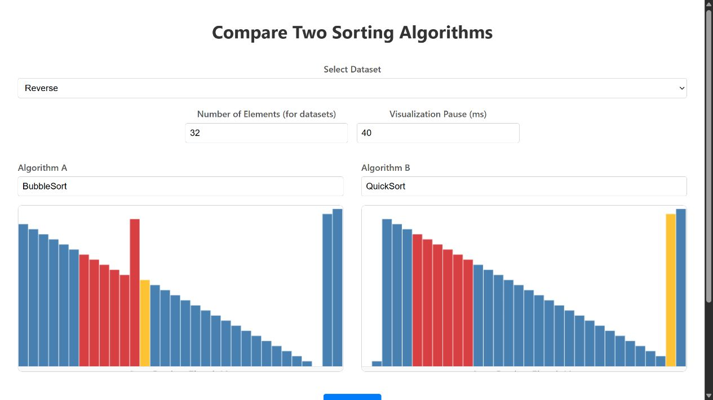
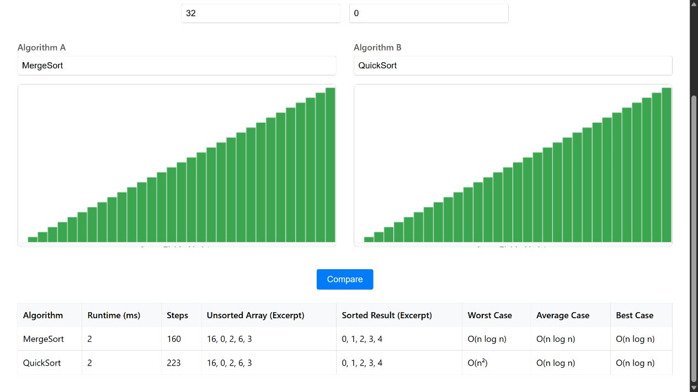

# Sortieralgorithmen vergleichen

**Java 17 · Spring Boot · HTML/CSS/JavaScript · Teamprojekt**

Zwei Sortierverfahren auf einen Blick: Die Webanwendung vergleicht Laufzeit und Schrittzahl und zeigt die Sortierung als animierte Balken. Zur Auswahl stehen 23 Verfahren und vier Arten von Eingabedaten.



[Projekt und Technik](docs/PROJEKT.md) · [Bildergalerie](docs/GALERIE.md) · [Quellcode herunterladen](https://github.com/Kennatris/dski-tcs-group4/archive/refs/heads/main.zip)

## Funktionen

- Zwei Verfahren über eine durchsuchbare Auswahl gegenüberstellen.
- Unsortierte, halb sortierte, sortierte oder umgekehrt sortierte Daten erzeugen.
- Anzahl der Elemente und Anzeigepause einstellen.
- Zugriffe und Änderungen während der Sortierung farbig hervorheben.
- Laufzeit, Schritte, Ergebnisausschnitte und theoretische Komplexität vergleichen.
- Einzelne Sortiervorgänge über Server-Sent Events im Browser darstellen.




## Lokal starten

Mit JDK 17 im Ordner `sorting-comparer`:

```powershell
.\mvnw.cmd verify
java -jar target/sorting-comparer-0.0.1-SNAPSHOT.jar --server.address=127.0.0.1 --server.port=8080
```

Danach [den Vergleich öffnen](http://127.0.0.1:8080/test.html). Die [Projektdokumentation](docs/PROJEKT.md) enthält die vollständige Verfahrensliste, den Linux-Aufruf und die REST-Schnittstellen.

> **Hinweis:** Dokumentation und Zusammenfassung wurden automatisiert durch einen Agenten erstellt und dienen der Veranschaulichung. Der Programmcode ist unverändert. Alle Angaben und Downloads ohne Gewähr.
