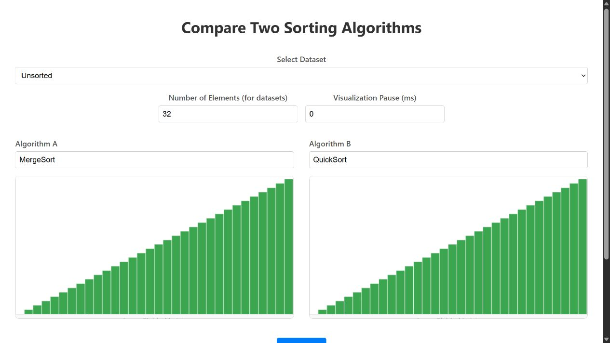
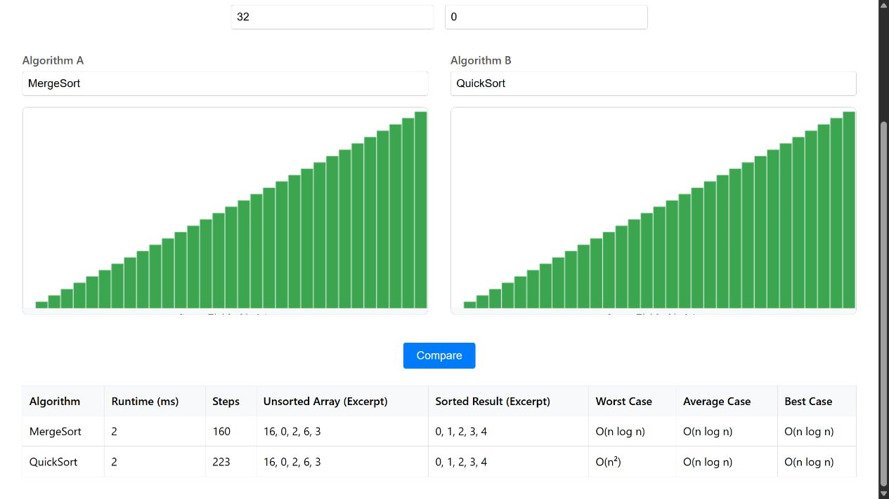
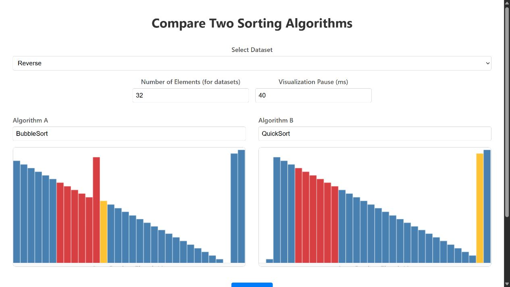

# Sortiervergleich – Galerie

Die Aufnahmen zeigen die lokal laufende Webanwendung. Eingestellt wurden jeweils 32 Elemente.

## Vergleich

MergeSort und QuickSort nach Abschluss ihrer Darstellung.

## Ergebnisse

Die Tabelle verbindet Laufzeit und Schrittzahl mit Eingabe-, Ergebnis- und Komplexitätsangaben.

## Laufende Sortierung

BubbleSort und QuickSort bearbeiten umgekehrt sortierte Daten. Farben markieren die gerade betrachteten und veränderten Elemente.

[Projekt und Technik](PROJEKT.md) · [Zur Übersicht](../README.md). Alle Angaben und Downloads ohne Gewähr.
